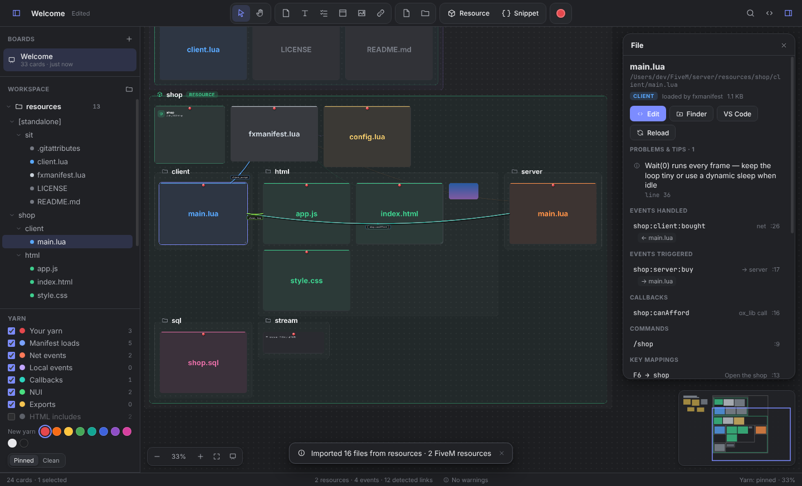
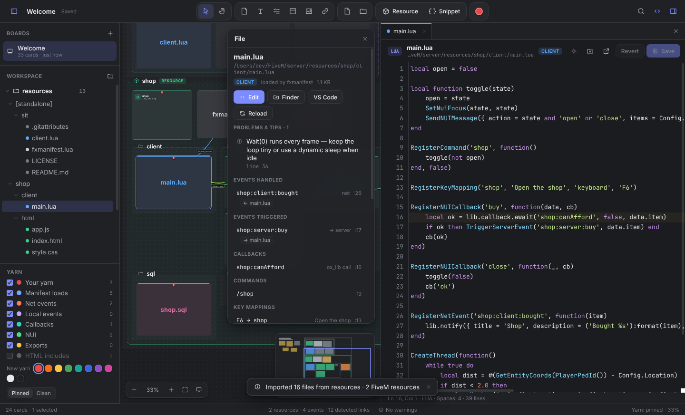

# FiveBoard

A planning board and code space for FiveM scripting, built as a desktop app for macOS.

Drop sticky notes, text, checklists, images, links and files anywhere on an infinite grey board, move them around freely, and tie them together with yarn, like a detective's corkboard. Import a resource folder, or your whole server `resources/` folder, and FiveBoard lays every folder out as a frame and every file as a card with its full contents, syntax highlighted. It then draws the connections in your code: what the manifest loads, which events go client → server and back, callbacks, NUI messages and exports.



## Features

**Planning board**
- Infinite canvas with smooth pan and zoom: trackpad scroll, pinch, ⌘-scroll, or Space-drag.
- Sticky notes in nine colors, big text headings, checklists with progress bars, images (drag in, paste or pick), link cards and frames for grouping.
- **Yarn:** drag a card's pin onto another card to connect them. Drop the yarn on empty space and a new note is created at the end. Each string can have its own color, label, dashed style and arrow. Two looks are available: **Pinned** (classic push pins with yarn on top) or **Clean** (yarn runs behind the cards).
- Multi-select (box or Shift-click), drag, resize, duplicate, copy/paste, align, arrange, group into frames, plus full undo/redo.
- Several boards, autosaved continuously. Export or import `.fiveboard` files to share them.
- Graphite (dark) and Silver (light) themes, a minimap, and ⌘K search across everything.

**Code space**
- **Import a folder:** every folder becomes a frame and every file a card showing its contents. Binary assets (`stream/*.ydr`, `.ytd`, audio, fonts…) are grouped into compact file lists, and small images show as pictures.
- **Built-in editor** (⌘E) with tabs, line numbers, bracket matching, find, comment toggling and **FiveM native autocomplete** (Ctrl+Space) that shows the parameters and whether each native is client- or server-side.
- Edits flow straight back to the card. Press ⌘S to save to disk. FiveBoard watches imported folders, so changes from VS Code or git show up on the board right away.
- Open any file in VS Code or Finder, or with its default app, from the card's menu.

**Made for FiveM**
- Parses `fxmanifest.lua` / `__resource.lua` (globs, `@resource/` includes, `ui_page`, `files`, `dependencies`, `data_file`…) and labels every script **CLIENT / SERVER / SHARED / CONFIG / NUI**.
- **Detected yarn:**
  - manifest → scripts
  - `TriggerServerEvent` → `RegisterNetEvent` (and server → client)
  - local events
  - ESX / QBCore / ox_lib callbacks
  - `SendNUIMessage` → JS message handlers
  - JS `fetch(...GetParentResourceName()...)` → `RegisterNUICallback`
  - `exports` across resources
  - HTML `<script>`/`<link>` includes
- Select a card and its connections light up above everything else. The inspector lists the events it handles and triggers (with the files on the other end), its commands and key mappings, NUI callbacks, exports, a function outline and the natives it uses.
- A summary card for every resource shows fx_version, game, lua54, script counts, frameworks (ESX, QBCore, Qbox, ox_lib, oxmysql…), dependencies and commands.
- **Problem finder:**
  - `while true do` without `Wait()`
  - `Wait(0)` hot loops
  - client-only natives in server scripts (and vice versa), e.g. `TriggerServerEvent` on the server
  - events with no handler
  - NUI callbacks that don't exist
  - scripts that `fxmanifest` never loads
  - a `ui_page` missing from `files {}`
  - a missing `fx_version`/`game`, or legacy `__resource.lua`
  - `GetPlayerPed(-1)`, `GetDistanceBetweenCoords`, and more
- **New resource from a template** (⇧⌘N): a client + server resource, or one with a full NUI page wired up. Edit it on the board, then use **Export to folder…** to write it into your server.
- **Snippets** (⇧⌘I): marker loops with dynamic sleep, blips, vehicle spawning, animations, key mappings, state bags, validated server events, ACE commands, oxmysql, ESX, QBCore, ox_lib callbacks, exports and a `server.cfg` starter.



## Install and run (macOS)

You need [Node.js](https://nodejs.org) 20 or newer.

```bash
cd fiveboard
npm install
npm start          # run FiveBoard
```

### Build a real Mac app

```bash
npm run dist       # creates dist/FiveBoard-1.0.0-arm64.dmg (Apple Silicon) and -x64.dmg (Intel)
```

Open the `.dmg` and drag **FiveBoard** into Applications.

The app isn't notarized by Apple. A copy you built yourself opens normally. If you download a build made elsewhere (for example from the GitHub Actions artifacts), macOS may say it "can't be opened" or "is damaged". In that case, right-click the app → **Open**, or run:

```bash
xattr -dr com.apple.quarantine /Applications/FiveBoard.app
```

Every push that changes `fiveboard/` runs the **Build FiveBoard (macOS)** workflow. You can also run it manually from the repository's **Actions** tab. The `.dmg` files are attached to each run as an artifact.

## Keyboard shortcuts

| Action | Shortcut |
| --- | --- |
| Sticky note / text / checklist / frame | N / T / L / G (or double-click the board) |
| Connect selection with yarn | ⌘L (or drag a card's pin) |
| Group selection in a frame | ⌘G |
| Search board · search in files | ⌘K · ⇧⌘F |
| Import folder · add files | ⇧⌘O · ⇧⌘A |
| New FiveM resource · snippet | ⇧⌘N · ⇧⌘I |
| Code editor · save · save all | ⌘E · ⌘S · ⌥⌘S |
| Zoom to fit · selection · 100% | ⌘1 · ⌘2 · ⌘0 |
| Undo / redo | ⌘Z / ⇧⌘Z |
| Select / hand tool | V / H (or hold Space) |
| All shortcuts | ⌘/ |

## Where things are stored

Boards are saved in `~/Library/Application Support/FiveBoard/boards/`. Imported files stay where they are: cards keep a copy of their contents so a board still opens when a folder has moved, and they reload from disk whenever the folder is available.

## Development

```bash
npm test           # FiveM analyzer unit tests (node:test)
```

- `src/main/` — Electron main process: window, secure `app://` protocol, folder scanning, file watching, board storage, menus
- `src/preload/` — the small API the renderer is allowed to use
- `src/renderer/js/board.js`, `yarn.js`, `items.js` — the canvas, yarn and card types
- `src/renderer/js/fivem/` — manifest parser, script analyzer, natives list, templates and snippets
- `src/renderer/js/editor.js` — CodeMirror editor drawer

The renderer has no Node access (context isolation, sandbox, strict CSP). File contents are only ever rendered as text.
